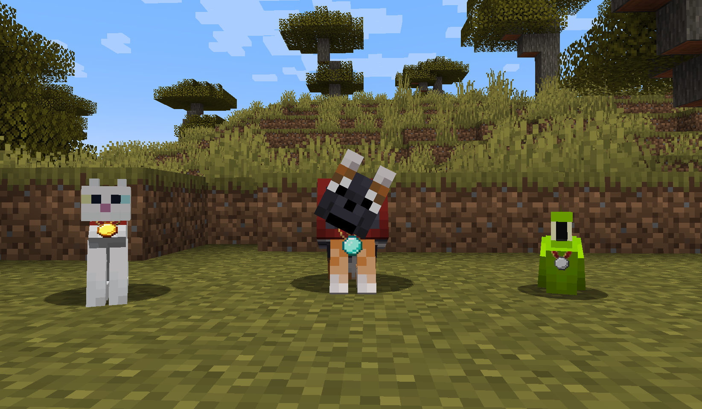
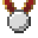
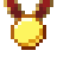
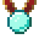
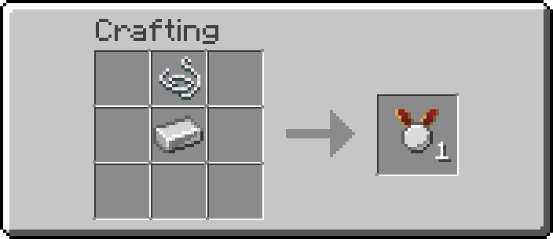
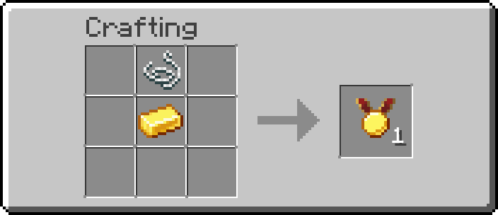
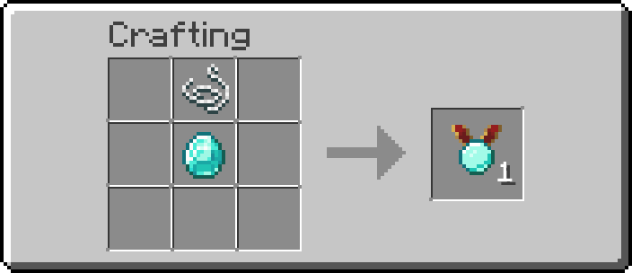
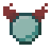
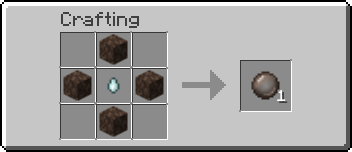
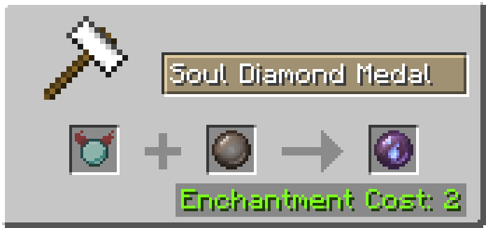

  

<h1 align="center">Pet Protect</h1>

<b>Don't accidentally hurt your dear loved friends anymore!</b>

---

You swing your sword at a zombie, your wolf jumps in front of you… and it's gone. **Pet Protect** puts an end to these tragedies.

Craft a **medal**, put it on your pet, and it becomes immune to your hits. With the best medals, your pet is also protected from your teammates, and it can even **come back from the dead**.

## Features

- **Three medals** (iron, gold, diamond), each with its own level of protection
- **No more friendly fire**: your pet ignores damage from you, and from your teammates with the better medals
- **Visible medals**: the medal is shown on wolves, cats and parrots
- **Resurrection**: a pet wearing a diamond medal leaves a soul medal when it dies, which can bring it back to life
- **Fully configurable**: every medal can be adjusted, directly in game
- Available in **English** and **French**

## The medals

| | Medal | Protects from its owner | Protects from teammates | Allows resurrection |
|:---:|---|:---:|:---:|:---:|
|  | **Iron Medal** | ✓ |   |   |
|  | **Gold Medal** | ✓ | ✓ |   |
|  | **Diamond Medal** | ✓ | ✓ | ✓ |

*Default values: server owners can change them (see Configuration below).*

### Crafting

A medal is made of a **string** placed above an **iron ingot**, a **gold ingot** or a **diamond**.

  
  
  

## How to use

### Putting a medal on your pet

**Right-click** your tamed pet while holding a medal. You hear a little sound and the medal appears on your pet.

- Only the **owner** of the pet can put or remove its medal.
- A pet can only wear **one medal** at a time.
- Works with **wolves**, **cats** and **parrots**. Tamed animals from other mods are protected too, but the medal is not displayed on them.

### Removing the medal

**Right-click** your pet with **shears**: the medal drops on the ground.

> If your wolf wears **wolf armor**, shears remove the armor first. **Sneak** while using the shears to remove the medal instead.

### Being protected

Once your pet wears a medal, your hits (sword, arrows, tridents…) no longer hurt it, and a sitting pet stays seated.

With a **gold** or **diamond** medal, your pet is also protected from your **teammates**. If PVP is disabled on the server, it is protected from **every player**.

## Resurrection

Even with a medal, your pet can still die from mobs, lava or a long fall. With a **diamond medal**, this is not the end!

### 1. Get the soul medal

When a pet wearing a diamond medal dies, it drops a **Soul Diamond Medal** instead of its medal. The soul of your pet is stored inside: hover over it to see its name and its owner.

  

### 2. Craft a Soul Vessel

Surround a **ghast tear** with **4 soul sand**.

  

### 3. Create the Resurrection Pearl

Put the **soul medal** and the **soul vessel** in an **anvil** (in any order). It costs **2 levels**.

  

### 4. Bring your pet back

**Throw** the Resurrection Pearl like an ender pearl. Your pet comes back where the pearl lands, with **full health**, its **name** and its **owner**.

> Your pet comes back **without its medal or armor**: armor is dropped when the pet dies, and the medal became the pearl. Don't forget to give it a new medal!

## ⚙️ Configuration

The settings can be changed in game: **Mods** menu → **Pet Protect** → **Config**. Each medal has its own settings.

| Setting | Side | Description |
|---|---|---|
| `protect_from_owner` | Server | The medal protects the pet from its owner's damage |
| `protect_from_team` | Server | The medal protects the pet from its owner's teammates, or from all players if PVP is off |
| `allow_resurrection` | Server | The pet drops a soul medal when it dies |
| `render_on_pet` | Client | The medal is displayed on the pet |

## Compatibility

| Minecraft | Loader |
|---|---|
| 1.21.1 | NeoForge |

## Credits

Made by **Wildyax** and **Rafidelf**.
